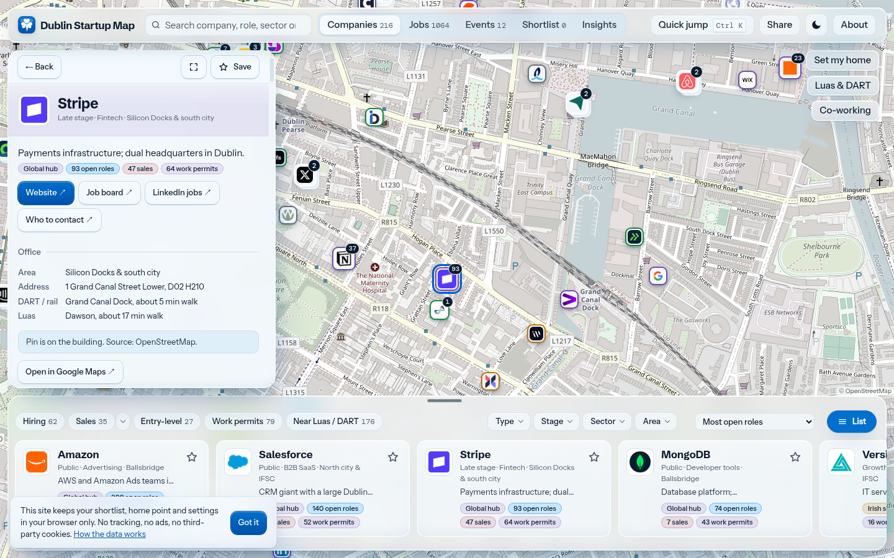
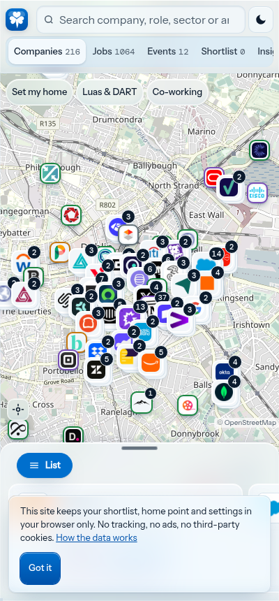

  

<h1 align="center">Dublin Startup Map</h1>

  <b>Every startup, scale-up and tech company hiring in Dublin — on one live, interactive map.</b>

  
  
  
  

  <a href="https://dublinstartupmap.ie"><b>▶ Open the live map</b></a>

  
   <i>Zoomed into the city — every company's logo sits where its office is. Click to open the live map →</i>

---

## What it is

A free, fast map that turns a job hunt in Dublin into a map you can read at a glance. Open roles, commute times and hiring history for every company, in one place — no sign-up, no ads.

## What it does

- 🗺️ **Companies on a map** — startups, scale-ups and global tech hubs across Dublin, by exact building or district.
- 💼 **Live open roles** — read from each company's own careers board and refreshed daily, searchable by title, team and category inside each company.
- 🚇 **Commute at a glance** — walking time to the nearest Luas and DART stop, and distance from your home.
- 🛂 **Work-permit history** — which companies were issued employment permits this year.
- ⭐ **Shortlist & tracker** — save companies, set a status and notes, export to CSV. Kept in your browser only.
- 🌗 **Dark / light** with an animated theme reveal, and **installable** as an app on your phone.

## See it in action

Open any company for its live roles, commute times and work-permit history — then search that company's jobs by title, team or category.

  
   On your phone: swipeable cards, a drag-up list, and <b>Add to Home Screen</b>

  <a href="https://dublinstartupmap.ie"><b>↳ Try the real thing at dublinstartupmap.ie</b></a>

## How it is built

| Layer | Tech |
| --- | --- |
| Map & UI | Leaflet + MarkerCluster, hand-written HTML / CSS / vanilla JS — no framework |
| Data pipeline | Python — company careers boards, public employment-permit records, transit stops |
| Hosting | Cloudflare Pages, deploys on push |
| Extras | PWA manifest, View Transitions, design-token theming |

## Privacy

Everything you save (shortlist, home point, settings) stays in **your browser**. No tracking, no third-party cookies, no accounts.

---

  The application source code and its datasets are kept in a private repository. This page is a project overview only — no code or data is published here.

  © 2026 Deepak Shebani · <a href="https://dublinstartupmap.ie">dublinstartupmap.ie</a> · <a href="https://www.linkedin.com/in/deepak-shebani">LinkedIn</a>

